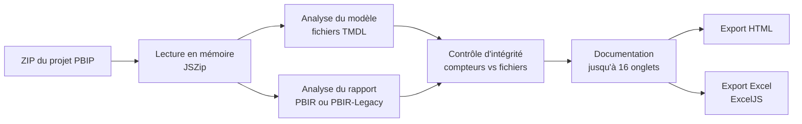

# Générateur de documentation PBIP

Un seul fichier HTML qui documente un modèle Power BI enregistré au format PBIP. On dépose le projet zippé, et l'outil produit en quelques secondes une documentation interactive : tables, relations, mesures, dépendances DAX, sources, code M, connexions, pages du rapport, sécurité et bonnes pratiques. Tout se passe dans le navigateur : aucune installation, et aucune donnée n'est envoyée nulle part.

L'exemple illustré ici est un vrai projet : le [rapport météo des musées](exemple/METEO_MUSEE-documentation.html) (4 tables, 12 mesures, 2 pages). Son export HTML et son export Excel sont fournis dans `exemple/`, pour les ouvrir sans rien installer.


## Sommaire

- [Ce que fait l'outil](#ce-que-fait-loutil)
- [Quand s'en servir](#quand-sen-servir)
- [Utiliser l'outil](#utiliser-loutil)
- [Ce que l'outil ne montre pas](#ce-que-loutil-ne-montre-pas)
- [Confidentialité](#confidentialité)
- [Fonctionnement](#fonctionnement)
- [Limites connues](#limites-connues)
- [Tests](#tests)
- [Alternatives](#alternatives)
- [Feuille de route](#feuille-de-route)
- [Retours](#retours)
- [Historique](#historique)
- [Structure du dépôt](#structure-du-dépôt)
- [Sources et crédits](#sources-et-crédits)
- [Licence](#licence)

## Ce que fait l'outil

La documentation compte jusqu'à 16 onglets. Un onglet sans contenu (pas de groupe de calcul, pas de rôle de sécurité…) n'est pas affiché.

| Onglet | À quoi il sert |
|---|---|
| Vue d'ensemble | Synthèse chiffrée, sources, **contrôle d'intégrité** : chaque compteur est comparé aux déclarations des fichiers |
| Tables | Une fiche par table : rôle déduit (fait, dimension, auxiliaire), niveau de confiance et raison, source, colonnes, clés |
| Relations | Cardinalités, sens du filtre, relations inactives ou bidirectionnelles |
| Mesures | Toutes les formules DAX, regroupées par table, avec recherche et copie |
| Colonnes | Colonnes sources et calculées, types, colonnes masquées |
| Dictionnaire de données | Colonnes et mesures dans une seule liste, pour chercher un champ dans tout le modèle |
| Dépendances DAX | Ce que chaque mesure utilise, et la vue inverse « où est-ce utilisé » pour les colonnes et pour les mesures |
| Sources & partitions | Mode de stockage, source et principales transformations de chaque table |
| Code M | Les requêtes Power Query, lisibles et copiables |
| Connexions | Serveurs, fichiers, dossiers et API, y compris derrière une requête partagée ou un paramètre. Une source non reconnue est signalée, jamais ignorée |
| Paramètres & expressions | Paramètres Power Query (avec leur valeur) et expressions partagées |
| Groupes de calcul | Éléments de calcul et leurs formules |
| Paramètres de champ | Champs proposés et leur ordre |
| Pages du rapport | Pages visibles et masquées, dans l'ordre du rapport, avec le nombre de visuels |
| Sécurité | Rôles RLS, filtres DAX, et tables atteintes par chaque filtre en suivant les relations |
| Bonnes pratiques | Règles d'analyse classées par gravité, avec un ordre de lecture |

**Par où commencer, selon le besoin**

| Je veux… | Onglet |
|---|---|
| Retrouver ou copier une formule | Mesures |
| Modifier ou supprimer une colonne ou une mesure sans rien casser | Dépendances DAX, vue « où est-ce utilisé » |
| Comprendre un total incohérent ou un filtre qui ne se propage pas | Relations |
| Savoir d'où viennent les données, et s'il faut une passerelle | Connexions |
| Chercher un champ dans tout le modèle | Dictionnaire de données |

La documentation s'exporte en **HTML** (un fichier autonome à partager) ou en **Excel** (dix feuilles en français, pour trier et filtrer). L'export HTML reste le plus complet : la sécurité, les groupes de calcul et les bonnes pratiques n'existent que dans l'export HTML.


## Quand s'en servir

| Situation | Pourquoi |
|---|---|
| Après chaque évolution du modèle | La documentation se refait en quelques secondes |
| Avant un audit de sécurité ou une revue RGPD | Les rôles RLS, leurs filtres et les connexions externes sont réunis au même endroit |
| Passation d'un modèle ou arrivée d'une nouvelle personne | Une documentation qui se lit sans avoir construit le modèle |
| Revue de gouvernance des données | Cartographie des sources et des connexions |

Bonne habitude : régénérer la documentation à chaque mise en production, et la conserver avec la version du modèle correspondante (par exemple dans le même dépôt Git).

## Utiliser l'outil

1. **Enregistrer le rapport en PBIP** dans Power BI Desktop : Fichier › Enregistrer sous › Power BI Project (.pbip). Le format PBIP existe depuis la version de juin 2023 de Power BI Desktop, d'abord en préversion. L'outil lit le modèle au format **TMDL** (dossier `.SemanticModel/definition/`). Si votre projet contient un fichier `model.bim` à la place, activez l'enregistrement au format TMDL dans les fonctionnalités en préversion (selon votre version), puis réenregistrez : l'outil affiche un message explicite dans ce cas.
2. **Supprimer le fichier `cache.abf`** du dossier `.pbi` du `.SemanticModel`. Il contient les données importées : l'outil n'en a pas besoin, et il peut être très lourd.
3. **Compresser en ZIP** les deux dossiers `.Report` et `.SemanticModel`. Le fichier `.pbip` n'est pas nécessaire. Compresser le dossier parent du projet fonctionne aussi.
4. **Ouvrir `generateur_documentation_francais.html`** dans le navigateur (double-clic), puis déposer le ZIP.


L'outil est testé avec Google Chrome (ou Chromium). Microsoft Edge, qui repose sur le même moteur, devrait fonctionner de la même façon ; Firefox et Safari n'ont pas été testés.

## Ce que l'outil ne montre pas

Ces informations ne sont pas stockées dans les fichiers PBIP : l'outil ne peut pas les afficher.

| Information | Où la trouver |
|---|---|
| Nombre de lignes des tables | Le fichier PBIX, ou le modèle sémantique dans le service Power BI |
| Contenu des données | Nulle part dans le projet : les lignes ne sont jamais stockées en PBIP (hors `cache.abf`) |
| Nom d'affichage d'un dataflow (seulement son identifiant) | Service Power BI, espace de travail › Dataflows, en associant l'identifiant |
| Identifiants de connexion, noms de passerelles, comptes | Le service Power BI ou le gestionnaire d'identifiants de Power BI Desktop |
| Membres des rôles de sécurité | Volontairement non affichés (ce sont souvent des adresses de messagerie) |

## Confidentialité

Le ZIP est lu en mémoire, dans le navigateur. L'outil ne fait **aucun appel réseau** : pas de serveur, pas de police ni de script chargé depuis Internet. Vous pouvez le vérifier en ouvrant les outils de développement du navigateur (onglet Réseau) pendant une génération ; les tests automatiques du dépôt le vérifient aussi.

C'est ce qui permet de documenter un modèle sensible (noms de serveurs, chaînes de connexion, règles de sécurité) sans rien exposer. Attention en revanche à **l'export** : il contient ces métadonnées, et un bandeau le rappelle en haut du fichier exporté. Les fichiers d'exemple de ce dépôt ne contiennent que des valeurs fictives (clé d'API `YOUR_API_KEY`, adresse SharePoint `votre-tenant`).

## Fonctionnement



| Étape | Ce qui se passe |
|---|---|
| Lecture | JSZip décompresse le ZIP directement dans le navigateur |
| Modèle | Les fichiers TMDL du dossier `.SemanticModel` sont analysés : tables, colonnes, mesures, relations, rôles, partitions, expressions, groupes de calcul |
| Rapport | Format PBIR (`definition/pages/`, ordre lu dans `pages.json`) ou PBIR-Legacy (`report.json`) : pages et visuels |
| Sources | Une seule détection, partagée par tous les onglets et l'export Excel. Le code M de chaque table est « résolu » : les requêtes partagées qu'il appelle sont suivies, les paramètres à valeur littérale sont remplacés |
| Contrôle d'intégrité | Tables, colonnes, mesures, relations, rôles, filtres de sécurité, éléments de groupes de calcul et pages sont recomptés directement dans les fichiers et comparés à ce que l'outil a extrait. Tout écart est affiché |
| Bonnes pratiques | 63 règles du fichier de bonnes pratiques publié par Microsoft, plus 2 règles maison, évaluées sans aucune donnée (8 autres règles du même fichier demandent des données ou ne concernent pas Power BI : elles sont listées, pas évaluées) |


Le TMDL est un format texte propre à Power BI. L'outil le lit avec des expressions régulières, pas avec un analyseur complet : c'est ce qui le rend léger et autonome, et c'est aussi sa principale limite. Le contrôle d'intégrité sert de garde-fou.

## Limites connues

- **Analyse par motifs de texte.** Un cas inhabituel dans le TMDL peut échapper à la détection. Le contrôle d'intégrité repère les écarts de comptage (une mesure ou une table manquante), pas une valeur mal lue à l'intérieur d'un objet.
- **Les dépendances DAX sont une estimation.** Elles sont lues dans le texte des formules (commentaires et chaînes ignorés, majuscules indifférentes), en direct seulement : une chaîne d'appels de mesure à mesure n'est pas dépliée, et une colonne citée sans sa table (`[Colonne]` dans un itérateur) n'est pas rattachée. L'usage dans les visuels n'est pas pris en compte. À vérifier avant toute suppression importante.
- **Authentification et passerelle sont indicatives.** Elles sont déduites du type de connecteur, pas lues dans le service.
- **Propagation de la sécurité calculée sur la définition.** À confirmer avec « Afficher en tant que rôle » dans Power BI Desktop.
- **Les bonnes pratiques sont des signaux.** Une règle déclenchée indique un point à regarder, pas une erreur certaine.
- **Format PBIP avec modèle TMDL uniquement.** Un fichier `.pbix` doit d'abord être enregistré en PBIP ; un modèle `model.bim` n'est pas lu.
- **Un seul modèle par ZIP.** Si le ZIP contient plusieurs projets, seul le premier modèle trouvé est documenté.
- **ZIP lourd.** Si le ZIP reste gros après suppression de `cache.abf`, le dossier `StaticResources` (images) peut en être la cause. L'outil ne l'utilise pas : vous pouvez le retirer du ZIP.

## Tests

Le dossier `tests/` contient un projet PBIP **fictif** conçu pour les cas limites : groupe de calcul, paramètre de champ, trois rôles RLS dont un filtre sur plusieurs lignes, nom de table avec apostrophe, sources CSV, SQL, dossier, API derrière une requête partagée, connecteur inconnu, mesure piège (commentaire, chaîne, majuscules), ordre des pages différent de l'ordre alphabétique. Il est décliné en rapport PBIR, en rapport PBIR-Legacy et en modèle `model.bim`.

```
pip install playwright
playwright install chromium
python tests/test_generateur.py
```

Le test ouvre le générateur dans Chromium sans interface, dépose les trois ZIP, et vérifie 26 points : compteurs, ordre des pages, groupes de calcul, sources, connexions, RLS, dépendances, absence d'erreur JavaScript et **absence de tout appel réseau**.

## Alternatives

D'autres outils documentent un modèle Power BI. Ils ne font pas tous la même chose, et certains vont plus loin sur des points précis.

| Outil | En bref |
|---|---|
| [Tabular Editor](https://tabulareditor.com/) (Best Practice Analyzer) | Applique le même jeu de règles Microsoft (`BPARules.json`) sur le modèle ouvert ; à installer, règles en anglais |
| [pbi-semantic-doc](https://pypi.org/project/pbi-semantic-doc/) | Outil Python (pip), pensé pour l'intégration continue ; produit du Markdown, du HTML ou du JSON |
| [PowerBI-Lineage](https://github.com/jonathan-pap/PowerBI-Lineage) | Documentation et lignage de projets PBIP, dans le navigateur (Chrome, Edge ou Opera) ou en ligne de commande ; produit aussi du Markdown pour un wiki |
| [PBIP Documenter](https://github.com/JonathanJihwanKim/pbip-documenter) | Documentation de projets PBIP dans le navigateur, avec un lignage visuel des sources jusqu'aux visuels |

Ce qui distingue cet outil : un fichier unique qui s'ouvre sans installation ni droits administrateur, même hors connexion ; une interface et un export Excel en français ; des règles de bonnes pratiques traduites ; un contrôle d'intégrité qui dit quand l'extraction est incomplète. Si vous avez besoin d'un lignage jusqu'aux visuels ou d'une intégration à une chaîne CI, les outils ci-dessus seront plus adaptés.

## Feuille de route

Pistes non engagées, classées par intérêt :

- **Usage dans les visuels** dans la vue « où est-ce utilisé » (les champs cités par le rapport sont déjà relevés pour les bonnes pratiques).
- **Dépendances indirectes** des mesures (chaînes d'appels).
- **Groupes de calcul et sécurité dans l'export Excel.**
- **Démonstration animée** des quatre étapes d'utilisation.

## Retours

L'outil est proposé pour être éprouvé en conditions réelles. Tous les retours sont utiles, y compris négatifs : utilité au quotidien, informations manquantes ou superflues, difficultés rencontrées, élément du modèle absent de la documentation.

Ouvrez une issue sur le dépôt. Si un modèle est mal lu, le plus utile est un petit projet PBIP **anonymisé** qui reproduit le problème.

## Historique

| Version | Changements |
|---|---|
| 1.0.0 (novembre 2026) | Première version publiée. Outil 100 % hors ligne (polices système à la place des polices en ligne). Thème sombre accessible (palette Okabe-Ito, contrastes WCAG AA). Détection des sources unifiée (elle était dupliquée à cinq endroits du code) et étendue : CSV, dossiers, `Web.BrowserContents`, OData, Analysis Services, connecteurs non reconnus signalés. Ordre des pages lu dans `pages.json`. Lecture des rapports PBIR-Legacy. Groupes de calcul lus selon la syntaxe TMDL officielle. Propagation des filtres de sécurité calculée. Dépendances DAX sans faux positifs dans les commentaires et les chaînes. Contrôle d'intégrité étendu (rôles, filtres, groupes de calcul, pages). Export Excel en français. Tests automatiques |
| Avant publication | 17 tables détectées sur 43 : un commentaire TMDL cassait la détection, corrigé et vérifié. Tables absentes de l'onglet Connexions quand la source passait par une fonction M personnalisée, corrigé. Onglet Dépendances DAX perdu lors d'une évolution, réintégré. Onglets restés en partie en anglais, traduits |

## Structure du dépôt

```
├── generateur_documentation_francais.html   L'outil, autonome (~1,3 Mo, dont ~1 Mo de bibliothèques)
├── Generateur_documentation_PBIP_comprendre_l_outil.pptx   Présentation de l'outil (12 diapositives)
├── docs/                    Captures d'écran du README
├── exemple/                 Export HTML et Excel du rapport météo des musées
├── tests/                   Projet PBIP fictif et test automatique
├── THIRD-PARTY.md           Bibliothèques et règles reprises, avec leurs licences
├── LICENSE
└── README.md
```

## Sources et crédits

| Élément | Source | Conditions |
|---|---|---|
| Idée de départ | Article [PowerBI Documentation Generator](https://medium.com/@ishaqbaig/powerbi-documentation-generator-6af7cd4cdbe8), Ishaq Baig (Medium) | Inspiration ; l'outil a depuis été entièrement redéveloppé |
| Lecture des ZIP | [JSZip](https://github.com/Stuk/jszip) 3.10.1, Stuart Knightley et contributeurs (inclut pako) | Licence MIT (ou GPLv3, au choix) |
| Export Excel | [ExcelJS](https://github.com/exceljs/exceljs) | Licence MIT |
| Règles de bonnes pratiques | [BPARules.json](https://github.com/microsoft/Analysis-Services/tree/master/BestPracticeRules), Microsoft | Licence MIT ; règles traduites et adaptées |
| Conception, code et relecture | lolita-debug, avec l'assistance de Claude (Anthropic) | — |

Le détail des licences tierces figure dans [THIRD-PARTY.md](THIRD-PARTY.md).

## Licence

Publié sous licence MIT : voir [LICENSE](LICENSE). Les bibliothèques et règles reprises restent soumises à leurs propres licences.
